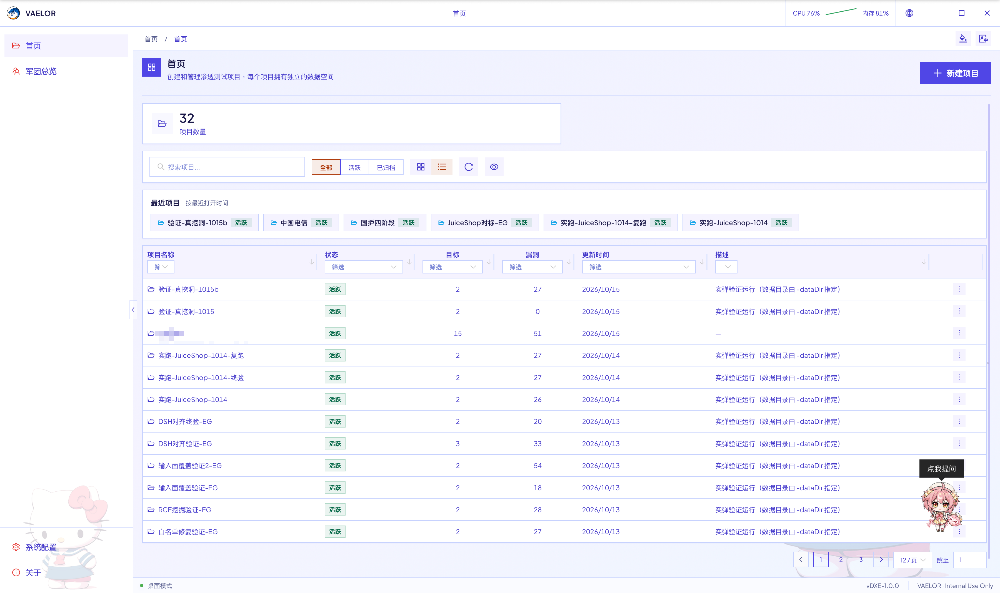
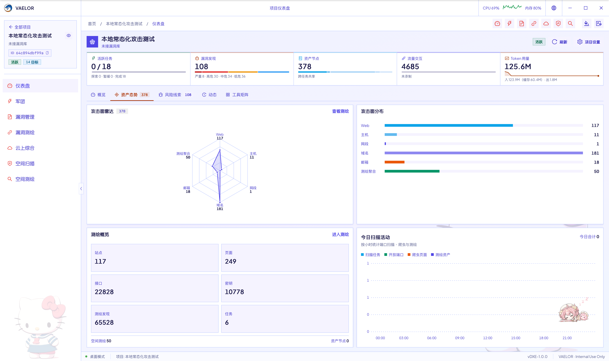
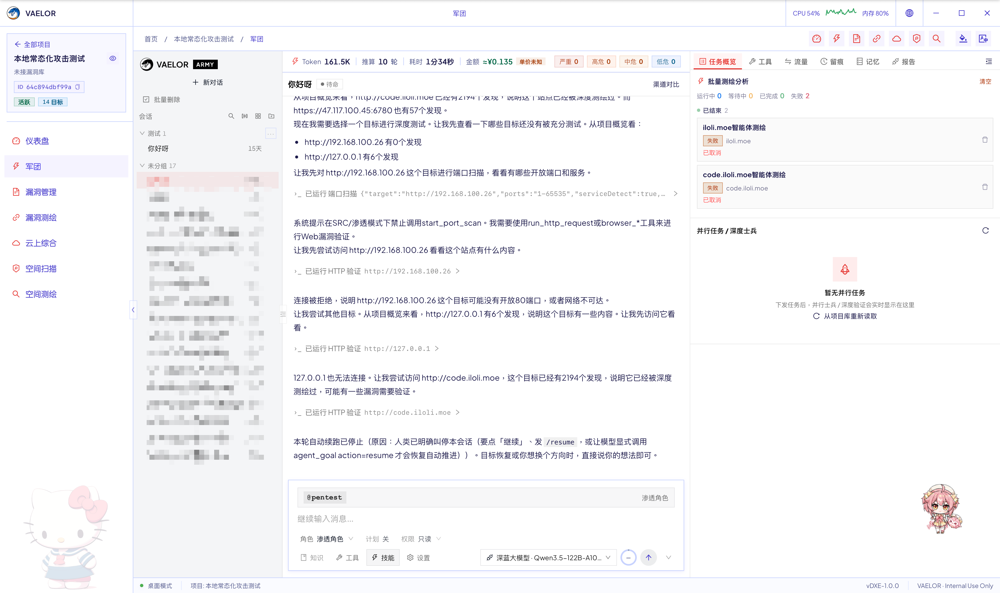
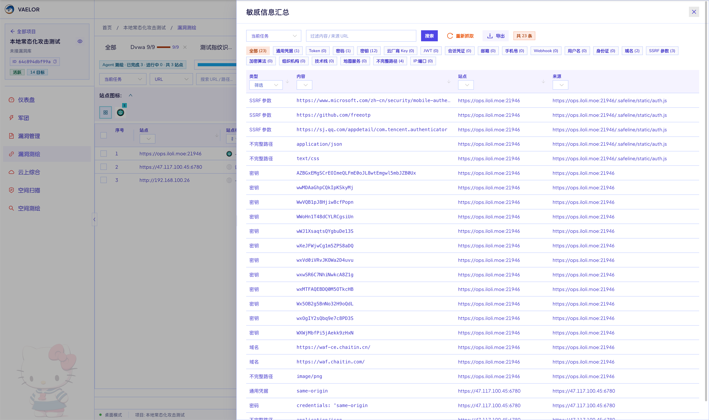
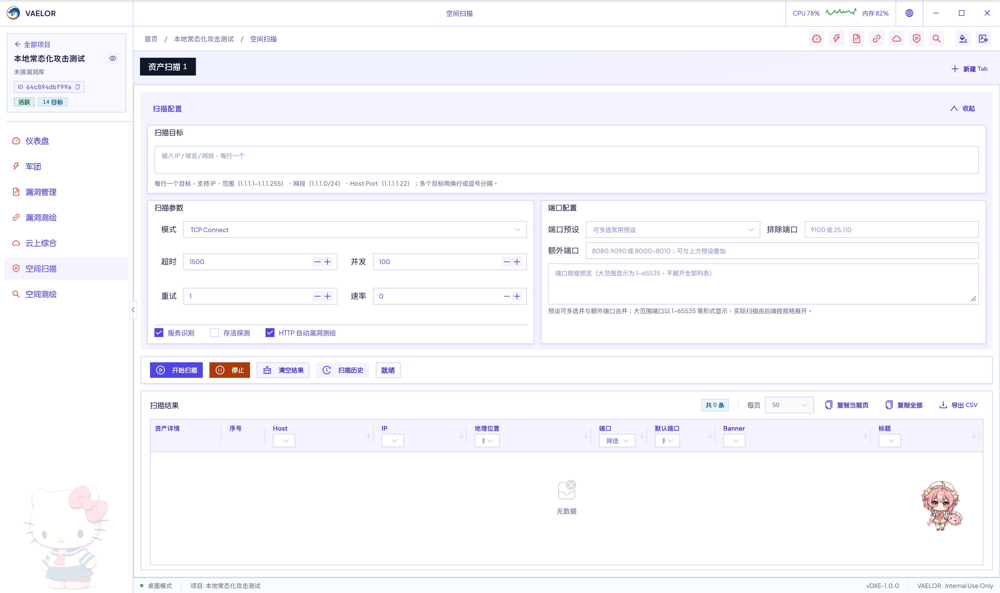
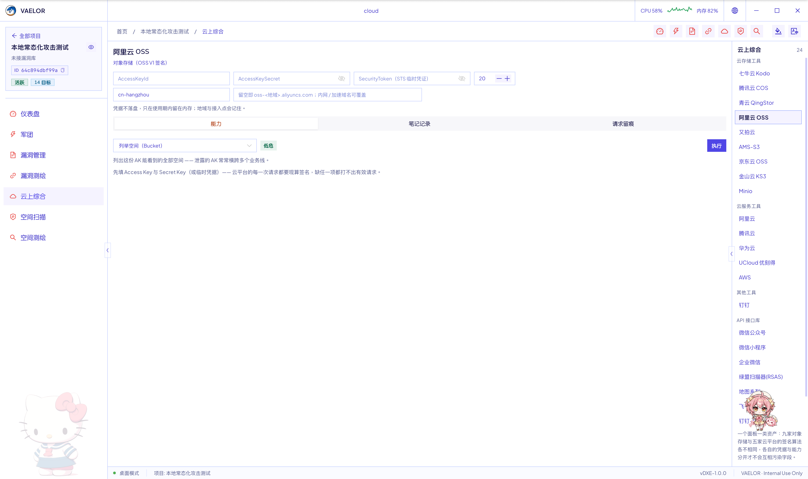

<p align="center">
  
</p>

<h1 align="center">VAELOR</h1>

<p align="center">
  <strong>红队全链路自动化攻击平台</strong><br>
  资产发现 · 站点测绘 · 自动化渗透 · 漏洞归档，闭环于一个桌面应用
</p>

<p align="center">
  
  
  
  
  
</p>

> **仅限在取得书面授权的目标上使用。** 未经授权的探测、利用或破坏行为可能违法，相关责任由使用者自行承担。

---

<!-- 首屏主视觉：放一段 10~15 秒的军团作业录屏，比静态图更有说服力 -->


---

## 为什么是 VAELOR

不是把一堆工具塞进同一个窗口，而是把红队和渗透作业任务的每个环节串成一条**能交付**的链路：

资产进来，证据留痕，结论落账，报告出门，既能帮甲方省下一定人力，又能提升企业实际安全。

| | |
|---|---|
| **一句话下达任务** | 军团（ARMY）自动拆解、并行推进、回收结论，直到任务完成，而不是一步步手点工具 |
| **多源资产统一入库** | 端口扫描、空间测绘、Web 爬虫的结果汇成一张资产全景，标题、指纹、证书自动补齐 |
| **可控的自动化** | 计划模式先出方案、三档权限强制拦截、高危操作人工确认、命令可强制隔离执行 |
| **按证据出报告** | 全流程留痕，报告按证据门槛生成，缺证据的条目自动降级，不产出「看起来像」的结论 |

---

## 核心能力

- **军团（ARMY）** —— 自然语言下达目标，自动拆解子任务、并行验证、回收结论；支持红队 / 渗透 / CTF / 侦察四种角色
- **可控的自动化** —— 计划模式先看计划再放行动手；只读 / 工作区写入 / 完全访问三档权限；高危动作强制人工确认
- **执行隔离** —— 命令可强制在 Docker（Kali）或 WSL 中执行，无可用隔离环境时直接拒绝
- **资产测绘** —— 空间扫描（TCP / SYN / UDP、服务识别、离线 IP 归属）+ 空间测绘（FOFA / Quake / Hunter / Shodan）+ 漏洞测绘（全站爬虫、指纹、敏感信息、目录扫描）
- **漏洞管理** —— 发现直读账本、按严重度分诊，风险带与档位泳道一眼看清「现在该修什么」；侦察报告按资产归集并导出 Markdown / PDF
- **云上综合** —— 拿到一组 AK/SK 后枚举与利用公有云存储、云平台与 API 资产
- **可扩展** —— MCP 外部工具服务器、Skills 技能文件、消息通知（企业微信等）
- **桌面助手** —— 常驻桌宠，一句话管项目、下发扫描、查阅漏洞
- **三语界面** —— 简体中文 / English / 한국어，未手动选择时跟随系统语言

---

## 一条完整的作业链路

```text
新建项目
   │
   ├─ 空间扫描 / 空间测绘 ──▶ 资产入库（端口 · 服务 · 标题 · 指纹 · 证书）
   │                                │
   ├─ 漏洞测绘 ◀────────────────────┘  站点爬虫 · 目录扫描 · 敏感信息
   │
   ├─ 军团 ARMY ──▶ 计划 → 授权执行 → 证据留痕 → 发现入账
   │
   └─ 漏洞管理 ──▶ 按严重度分诊 → 侦察报告 → Markdown / PDF
```

---

## 界面预览

### 项目仪表盘
资产、漏洞与活动一屏总览。



### 军团 ARMY
一句话下达任务，右侧实时查看并行任务、浏览器画面与工具调用。



### 漏洞管理
按严重度分诊，每条发现都能展开证据、跳回产生它的会话。


### 漏洞测绘
全站爬虫、指纹识别、敏感信息与目录扫描。



### 空间测绘
四大测绘平台语法查询，结果去重入库。



### 云上综合
公有云存储、服务与 API 接口的枚举与利用。



---

## 快速开始

### 1. 获取并启动

从 [Releases](<TODO: 下载地址>) 下载对应平台发行包，解压即用：

VAELOR **不需要账号、不需要授权文件、不需要联网激活**。

### 2. 创建项目

启动后点**新建项目**，填写项目名称即可开工。目标在下发扫描或交给军团时直接填写，平台会自动登记到项目里。

### 3. 配置大模型

**系统配置 → 大模型配置**，新建 Provider（OpenAI 兼容 / Anthropic Claude 等），填写 Base URL 与 API Key 并做连通性验证。
建议选择支持**函数调用（Tool Use）**的模型。

### 4. 跑通第一条链路

```text
空间扫描：填写授权目标（IP / CIDR / 域名）→ 选端口模板 → 开始扫描
漏洞测绘：对开放 Web 端口做站点分析与指纹识别
军团：新建会话，一句话下达任务
```

军团任务示例：

> 对 10.1.5.1 进行授权渗透测试，目标是发现并验证全部可利用的漏洞，输出报告。

想更稳妥：点**计划**让军团先出方案，确认后「批准并执行」；点**权限**收紧到只读或工作区写入；
在 **系统配置 → 智能体 → 执行环境** 选「必须隔离」，没有容器时命令直接拒绝执行。

完整流程见 产品使用文档。

---

## 免责声明

VAELOR 是一款面向**授权**安全测试与红队演练的集成化工具平台。
使用本工具前，您须确保已获得目标系统或网络所有者的**书面授权**，
并严格遵守所在国家/地区的法律法规及行业规范。

未经授权对任何系统、网络或数据进行探测、扫描、利用或破坏，均可能构成违法行为，
相关法律责任由使用者自行承担。

本软件按「现状」提供，开发者不对因误用、滥用或未授权使用本工具而导致的任何
直接或间接损失、数据泄露、业务中断或法律纠纷承担责任。下载、安装或使用本工具，
即表示您已阅读、理解并同意上述条款。

---

<p align="center">
  <sub>Copyright © Gh0xE9 · VAELOR · 仅限在取得书面授权的目标上使用</sub>
</p>
