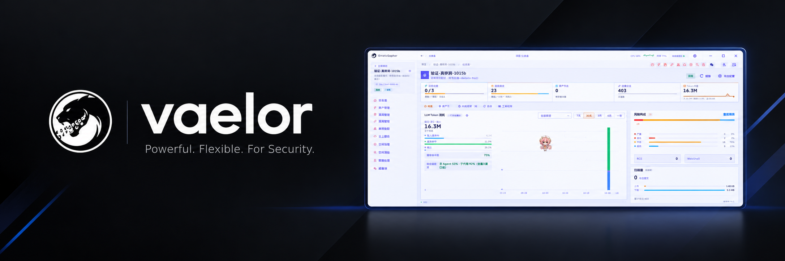

# VAELOR - Full-Chain Automated Attack Framework

**全链路自动化攻击框架** — 面向**授权**渗透测试与攻防演练的集成化桌面工具。

> **仅限在取得书面授权的目标上使用。** 未经授权的探测、利用或破坏行为可能违法，相关责任由使用者自行承担

---

## 目录

- [简介](#简介)
- [功能模块](#功能使用)
- [免责声明](#免责声明)

---

## 简介

VAELOR 把**资产发现**、**站点测绘**、**自动化渗透**、**漏洞归档**串成一条链路，
数据按**项目**隔离，各模块结果互相联动。核心是 LLM 驱动的 **ReACT 智能体**：
它自己决定调哪个工具、看什么结果、下一步打哪里，最后把可复现的漏洞结论落进账本。

核心特性：

- **智能体引擎**：多 Provider 对接，多步推理，自动调用扫描器 / 浏览器 / 测绘平台
- **Headless 浏览器实测**：SPA 渲染、表单填充、截图取证、敏感信息提取
- **多源资产融合**：端口扫描 + 空间测绘 + Web 爬虫结果统一入库，形成资产全景
- **漏洞账本 + 报告**：全流程留痕，报告按证据门槛生成，缺证据的条目会被降级
- **双通信形态**：桌面（Wails WebView）与 Web（HTTP + WebSocket）同一份后端

---

## 功能使用

## 免责声明

VAELOR 是一款面向**授权**安全测试与红队演练的集成化工具平台。
使用本工具前，您须确保已获得目标系统或网络所有者的**书面授权**，
并严格遵守所在国家/地区的法律法规及行业规范。

未经授权对任何系统、网络或数据进行探测、扫描、利用或破坏，均可能构成违法行为，
相关法律责任由使用者自行承担。

本软件按「现状」提供，开发者不对因误用、滥用或未授权使用本工具而导致的任何
直接或间接损失、数据泄露、业务中断或法律纠纷承担责任。下载、安装或使用本工具，
即表示您已阅读、理解并同意上述条款。
